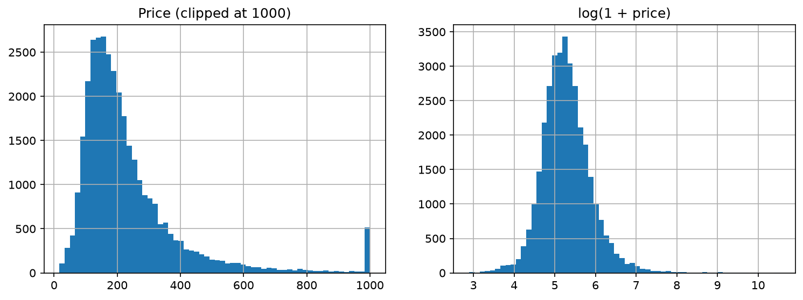
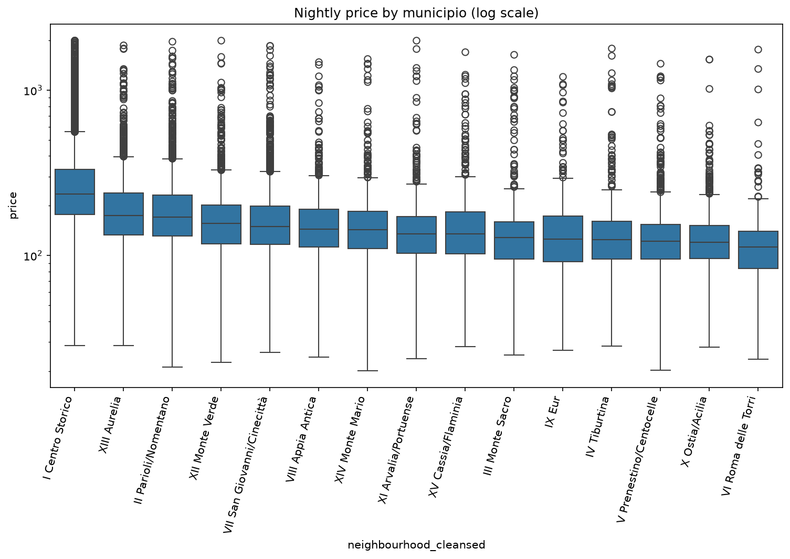
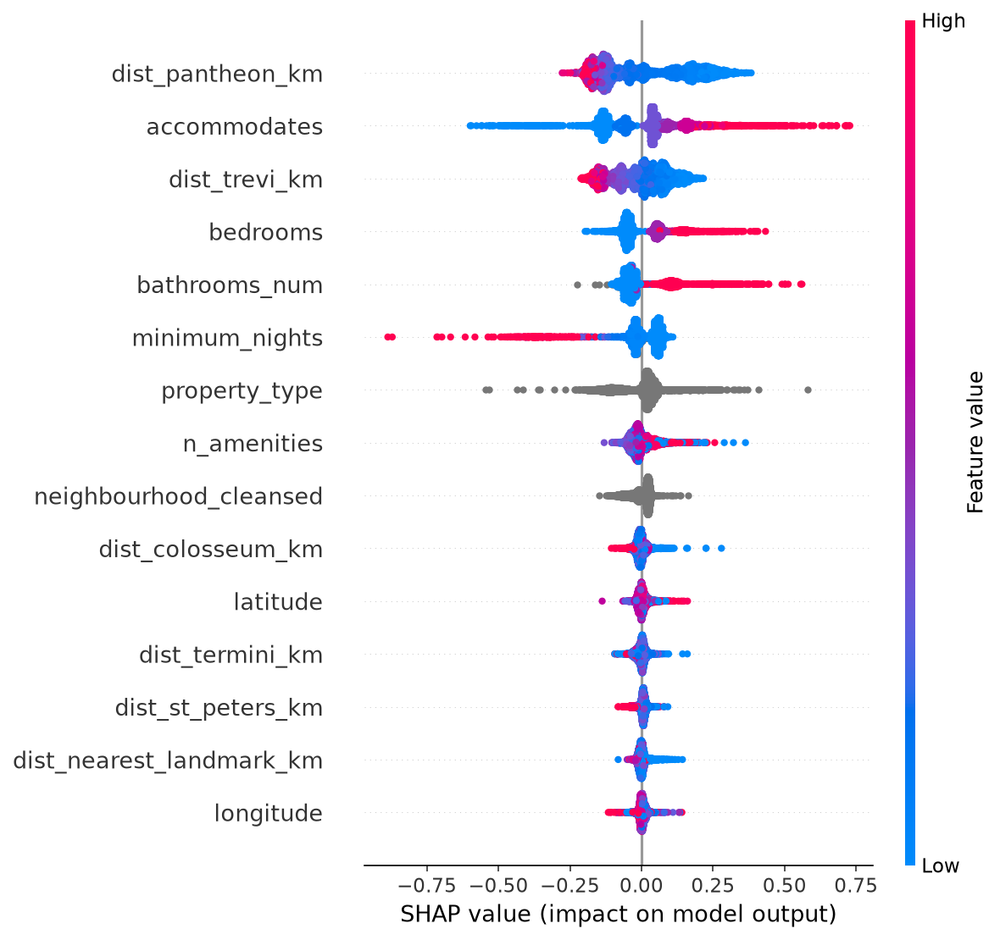
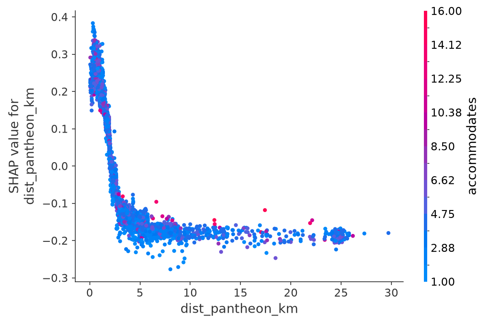

# Airbnb Rome: Nightly Price Prediction

Predicting nightly prices of Airbnb listings in Rome and understanding what drives them (location, property type, capacity), using open data from [Inside Airbnb](https://insideairbnb.com/get-the-data/).


**[Live demo: Rome Airbnb price estimator](https://airbnb-rome-price-pqy3sfmquevpdg6h5javbb.streamlit.app/)**


## Business question
What drives the nightly price of an Airbnb listing in Rome, and how can a host estimate a fair price for a new listing?

## Success metric
- MAE (in the currency of the dataset) and R² on log price, measured in cross-validation
- Compared against a baseline: median log price per municipio and room type
- Errors reported separately for Centro Storico and the rest of the city

## Data
- Source: Inside Airbnb, Rome, Lazio, Italy (`listings.csv.gz`, detailed listings)
- Snapshot date: *(add the date shown on the website)*
- Licence: *(check the licence on the Inside Airbnb site and add it here)*
- Raw size: 37,451 listings, 90 columns
- The `price` column is stored as text with a `$` sign (e.g. `$66.00`) and was converted to a number. Some values have cents, which suggests currency conversion in the source data.

The raw data is not stored in this repository (see `.gitignore`). Download `listings.csv.gz` and place it in `data/raw/`.

## Data cleaning
- Removed 3,518 listings with no price
- Removed 164 listings with a price outside 20-2000 per night. The most extreme values (up to 37,474 for a 2-guest apartment) are clearly errors
- Result: 33,769 listings
- The target is `log(1 + price)` because the price distribution is strongly right-skewed (raw median ~188, mean ~254)

## Key EDA findings
- **Skewed prices:** the log transform gives an almost symmetric distribution, which suits both linear models and gradient boosting.
- **The data is concentrated in the centre:** 52% of listings (17,597 of 33,769) are in I Centro Storico, so model quality is reported separately for the centre and the other municipi.
- **Centro Storico is the most expensive area:** median 235.7 per night, versus 113-174 in the other municipi. It also has the widest spread of prices, which suggests that finer location features (distance to landmarks) should add information.
- **Other municipi differ only slightly:** the boxes overlap heavily, so the district alone does not explain the price.
- **Property type matters:** entire homes (25,281 listings, median 205.4) are about 48% more expensive than private rooms (8,262 listings, median 139.0). Hotel rooms (154) and shared rooms (72) are rare, so their statistics are unreliable.
- **Capacity:** the median price grows steadily with the number of guests, from 85 (1 guest) to 613 (12 guests). Price per guest falls from ~85 (1 guest) to ~74 (2) and ~49 (4), then stays around 45-51 for 5+ guests. Listings for 2 and 4 guests make up ~59% of the data, and groups of 9+ guests are small (under 270 listings each).
- **Distance to landmarks:** across the whole city, log(price) is negatively correlated with the distance to all five landmarks (r from -0.28 to -0.36, strongest for the Pantheon, Trevi and St. Peter's). Inside Centro Storico the correlation stays strong for the Pantheon (-0.35) and Trevi (-0.33) but almost disappears for Termini (-0.05) and weakens for the Colosseum (-0.12) and St. Peter's (-0.11). Within the centre, price therefore depends on proximity to the historic core (Pantheon / Trevi) rather than on distance to landmarks in general. "Distance to the nearest landmark" is weaker (-0.18) than the Pantheon distance alone, because different listings have different nearest landmarks.

## Figures
| | |
|---|---|
|  |  |

## Modelling
- **Features (v1):** accommodates, bedrooms, beds, latitude, longitude, distances to 5 landmarks (Colosseum, Termini, St. Peter's, Pantheon, Trevi), distance to the nearest of them, room type, municipio. Reviews and ratings are deliberately excluded: a new listing has none.
- **Features (v2):** v1 plus number of amenities, number of bathrooms, minimum nights, property type.
- **Baseline:** median log price per (municipio, room type), computed on the training part of each fold only.
- **Model:** LightGBM (500 trees, learning rate 0.05, 31 leaves), target `log(1 + price)`.
- **Validation:** 5-fold CV. Because one host often lists several similar apartments (17,974 hosts for 33,769 listings), the final numbers use GroupKFold by `host_id`.

## Results
| Model | CV | MAE all | MAE centre | MAE rest | R² (log) |
|---|---|---|---|---|---|
| Baseline | grouped by host | 86.8 | 108.6 | 63.1 | 0.299 |
| LightGBM v1 (location + capacity) | grouped by host | 67.5 | 80.8 | 53.0 | 0.553 |
| LightGBM v2 (+ amenities, bathrooms, minimum nights, property type) | grouped by host | 64.1 | 76.8 | 50.2 | 0.600 |

- LightGBM v2 reduces MAE by about 26% compared with the baseline (64.1 vs 86.8) and doubles R² on log price (0.60 vs 0.30).
- Adding listing features (v1 → v2) lowers MAE by about 5% (67.5 → 64.1).
- Random K-fold gave slightly optimistic numbers for v1 (MAE 66.0, R² 0.578), because one host often lists several similar apartments. Grouping by host gives the fairer estimate.
- The median absolute percentage error of v1 is similar in the centre and elsewhere (20.4% vs 19.9%): the higher MAE in the centre simply reflects higher prices.
- By gain importance (v1), the distance to the Pantheon is the most informative feature, ahead of capacity and bedrooms, followed by the distance to Trevi.
- **Tested and rejected:** adding the distance to Piazza Navona (v3) did not improve the model (MAE 64.1, R² 0.601 vs 0.600 for v2, same data and folds). It lies about 500 m from the Pantheon, so the information overlaps. It is not part of the final feature set.

## Interpretation (SHAP, LightGBM v2)



- The most influential features are the distance to the Pantheon, capacity (accommodates), the distance to Trevi, bedrooms and bathrooms.
- The effect of the distance to the Pantheon is non-linear: the contribution drops sharply within the first ~3 km and flattens beyond ~5 km. Between the centre and the outskirts the model's log-price differs by roughly 0.5 (about 1.6x), all else equal.
- Long minimum stays (a month or more) push the nightly price down strongly, probably reflecting discounted mid-term rentals (hypothesis, not tested).
- More amenities add a modest premium.

## Error analysis
- The model shrinks predictions towards the middle: the cheapest 20% of listings are overestimated (median error +27) and the most expensive 20% are underestimated (median error -88).
- Relative error is stable across capacity (about 19-23%), while absolute error grows with price.
- All 20 largest errors are underestimates of listings priced 1500-2000; 7 of them are priced exactly 2000, which suggests placeholder or erroneous prices (e.g. a private room for 2 guests at 2000/night).
- Median absolute error is 35.7, well below the MAE of 64.1: the average is inflated by a small tail. Listings priced above 1000 are only 1.0% of the data but produce 12.2% of the total absolute error. Excluding them would lower the MAE to 56.8 (for illustration only: this filters on the true price, which is unknown for a new listing). For this reason both MAE and median absolute error are reported.
- Hotel and shared rooms are rare (154 and 72 listings), so their errors are unreliable.

## Takeaways for a host setting a price
(These describe patterns in the model, not causal effects.)
- Location in the historic core is the strongest driver: the premium falls sharply within the first ~3 km from the Pantheon and is flat beyond ~5 km.
- Capacity, bedrooms and bathrooms come next; price per guest drops as the apartment gets bigger.
- Long minimum stays are associated with much lower nightly prices (probably discounted mid-term rentals).
- A typical prediction is off by about 36 per night (median absolute error); the average error is 64.

## Limitations
- One snapshot: no seasonality, no events, no price changes over time.
- Prices are listed prices, not what guests actually paid, and a small tail of listings probably has erroneous prices (e.g. many at exactly 2000).
- Prices are converted to a single currency by the data provider.
- The model shrinks predictions towards the middle: cheap listings are overestimated, expensive ones underestimated.
- No photos, descriptions or reviews are used. Reviews are excluded deliberately because a new listing has none.
- Validation is grouped by host but not by location, so performance in an unseen neighbourhood is not measured.
- SHAP was computed on a sample of 5,000 listings and describes the model, not causes.
- Landmark coordinates are approximate.

## Possible next steps
- Text features from listing titles and descriptions (e.g. embeddings).
- Hyperparameter tuning and a CatBoost comparison.
- Predicting log-price quantiles to give hosts a price range.
- A small Streamlit app where a host enters a listing and gets a price range.

## Project structure
```
airbnb-rome-price/
├── README.md
├── requirements.txt
├── data/raw/            # not tracked by git
├── notebooks/
│   ├── 01_eda.ipynb
│   ├── 02_modeling.ipynb
│   └── 03_interpretation.ipynb
├── src/
│   ├── data.py
│   └── features.py
└── reports/figures/
```

## How to run
```bash
python -m venv .venv
.venv\Scripts\activate          # Windows
pip install -r requirements.txt
```
Download the data into `data/raw/`, then run the notebooks in order: `01_eda.ipynb`, `02_modeling.ipynb`, `03_interpretation.ipynb`.

## Plan
- [x] Repository setup, data loading, cleaning
- [x] EDA: price distribution, municipio, room type, capacity, price map
- [x] Distance features and correlation check
- [x] Baseline and LightGBM v1, host-grouped CV
- [x] Extra features: amenities count, bathrooms, property type, minimum nights
- [x] Distance to Piazza Navona: tested, no effect
- [x] SHAP interpretation and error analysis
- [x] Takeaways and limitations
- [ ] Quantile model / Streamlit app

## Tools
Python, pandas, NumPy, matplotlib, seaborn, scikit-learn, LightGBM, SHAP