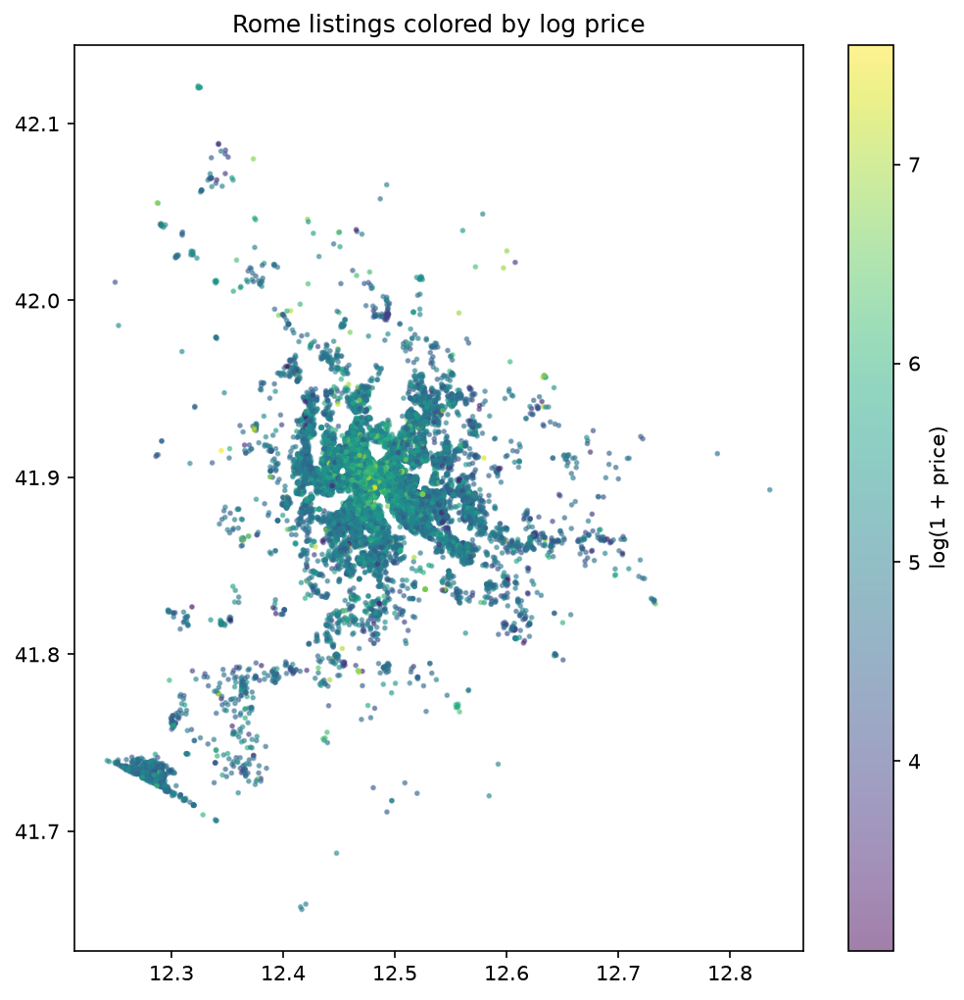

# Airbnb Rome: Nightly Price Prediction

Predicting nightly prices of Airbnb listings in Rome and understanding what drives them (location, property type, capacity), using open data from [Inside Airbnb](https://insideairbnb.com/get-the-data/). The final model is deployed as a small web app that gives a host an estimated price and a likely range.

**[Live demo: Rome Airbnb price estimator](https://airbnb-rome-price-pqy3sfmquevpdg6h5javbb.streamlit.app/)**
(if the app is asleep, click the wake-up button; it starts in about a minute)

## Business question
What drives the nightly price of an Airbnb listing in Rome, and how can a host estimate a fair price for a new listing?

## Success metric
- MAE (in the currency of the dataset) and R² on log price, measured in cross-validation
- Compared against a baseline: median log price per municipio and room type
- Errors reported separately for Centro Storico and the rest of the city

## Data
- Source: Inside Airbnb, Rome, Lazio, Italy (`listings.csv.gz`, detailed listings)
- Snapshot date: *(add the date shown on the website)*
- Licence: *(check the licence on the Inside Airbnb site and add it here)*
- Raw size: 37,451 listings, 90 columns
- The `price` column is stored as text with a `$` sign (e.g. `$66.00`) and was converted to a number. Some values have cents, which suggests currency conversion in the source data.

The raw data is not stored in this repository (see `.gitignore`). Download `listings.csv.gz` and place it in `data/raw/`.

## Data cleaning
- Removed 3,518 listings with no price
- Removed 164 listings with a price outside 20-2000 per night. The most extreme values (up to 37,474 for a 2-guest apartment) are clearly errors
- Result: 33,769 listings
- The target is `log(1 + price)` because the price distribution is strongly right-skewed (raw median ~188, mean ~254)

## Key EDA findings
- **Skewed prices:** the log transform gives an almost symmetric distribution, which suits both linear models and gradient boosting.
- **The data is concentrated in the centre:** 52% of listings (17,597 of 33,769) are in I Centro Storico, so model quality is reported separately for the centre and the other municipi.
- **Centro Storico is the most expensive area:** median 235.7 per night, versus 113-174 in the other municipi. It also has the widest spread of prices, which suggests that finer location