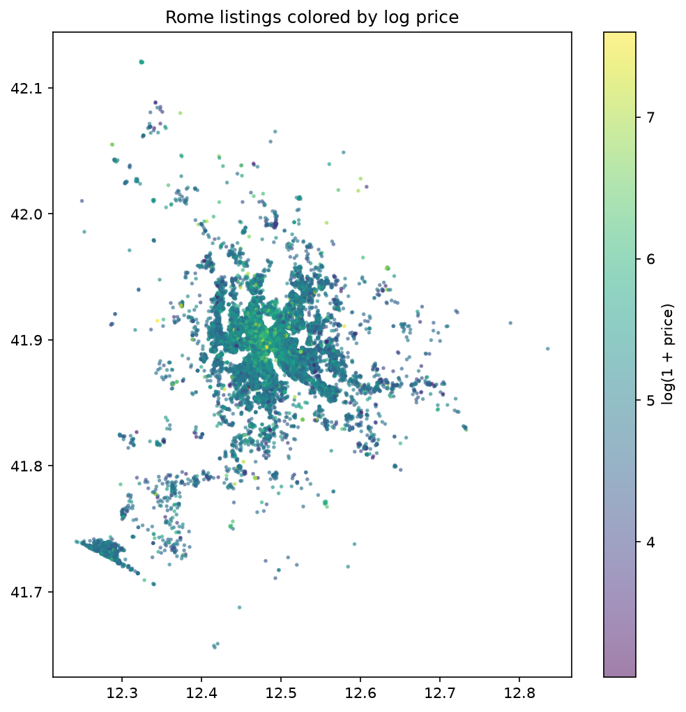
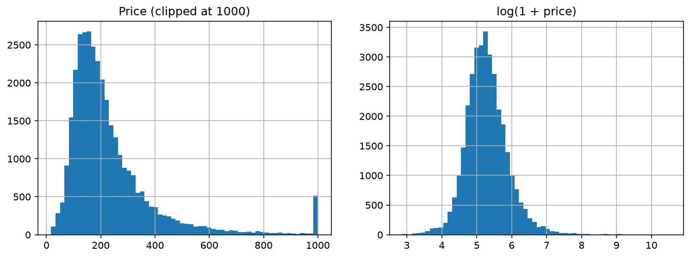
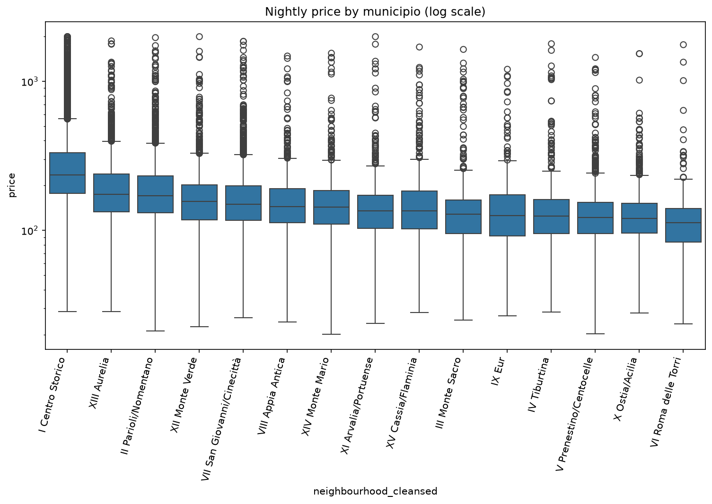

# Airbnb Rome: Nightly Price Prediction

Predicting nightly prices of Airbnb listings in Rome and understanding what drives them (location, property type, capacity), using open data from [Inside Airbnb](https://insideairbnb.com/get-the-data/).



## Business question
What drives the nightly price of an Airbnb listing in Rome, and how can a host estimate a fair price for a new listing?

## Success metric
- MAE (in the currency of the dataset) and R² on a held-out set
- Compared against a baseline: median price per neighbourhood and room type
- Errors reported separately for Centro Storico and the rest of the city

## Data
- Source: Inside Airbnb, Rome, Lazio, Italy (`listings.csv.gz`, detailed listings)
- Snapshot date: *(add the date shown on the website)*
- Licence: *(check the licence on the Inside Airbnb site and add it here)*
- Raw size: 37,451 listings, 90 columns
- Note: the `price` column is stored as text with a `$` sign (e.g. `$66.00`) and had to be converted to a number. Some values have cents, which suggests currency conversion in the source data.

The raw data is not stored in this repository (see `.gitignore`). Download `listings.csv.gz` and place it in `data/raw/`.

## Data cleaning
- Removed 3,518 listings with no price
- Removed 164 listings with a price outside 20-2000 per night. The most extreme values (up to 37,474 for a 2-guest apartment) are clearly errors
- Result: 33,769 listings
- The target is modelled as `log(1 + price)` because the price distribution is strongly right-skewed (raw median ~188, mean ~254)

## Key EDA findings
- **Skewed prices:** the log transform gives an almost symmetric distribution, which suits both linear models and gradient boosting.
- **The data is concentrated in the centre:** 52% of listings (17,597 of 33,769) are in I Centro Storico, so model quality is reported separately for the centre and the other municipi.
- **Centro Storico is the most expensive area:** median 235.7 per night, versus 113-174 in the other municipi. It also has the widest spread of prices, which suggests that finer location features (distance to landmarks) should add information.
- **Other municipi differ only slightly:** the boxes overlap heavily, so the district alone does not explain the price.
- **Property type matters:** entire homes (25,281 listings, median 205.4) are about 48% more expensive than private rooms (8,262 listings, median 139.0). Hotel rooms (154) and shared rooms (72) are rare, so their statistics are unreliable.
**Capacity:** the median price grows steadily with the number of guests, from 85 (1 guest) to 613 (12 guests). Price per guest falls from ~85 (1 guest) to ~74 (2) and ~49 (4), then stays around 45-51 for 5+ guests. Listings for 2 and 4 guests make up ~59% of the data, and groups of 9+ guests are small (under 270 listings each).
- **Distance to landmarks:** across the whole city, log(price) is negatively
  correlated with the distance to all five landmarks (r from -0.28 to -0.36,
  strongest for the Pantheon, Trevi and St. Peter's). Inside Centro Storico
  the picture is more specific: the correlation stays strong for the Pantheon
  (-0.35) and Trevi (-0.33) but almost disappears for Termini (-0.05) and
  weakens for the Colosseum (-0.12) and St. Peter's (-0.11). Within the
  centre, price therefore depends on proximity to the historic core
  (Pantheon / Navona / Trevi) rather than on distance to landmarks in general.
  The "distance to nearest landmark" feature is weaker (-0.18) than the
  Pantheon distance alone, because different listings have different nearest
  landmarks.

## Figures
| | |
|---|---|
|  |  |

*(add `price_map.png` here once it is created)*

## Modelling
- **Features (v1):** accommodates, bedrooms, beds, latitude, longitude, distances to 5 landmarks, nearest-landmark distance, room type, municipio. Reviews and ratings are deliberately excluded: a new listing has none.
- **Features (v2):** v1 plus number of amenities, number of bathrooms, minimum nights, property type
- **Baseline:** median log price per (municipio, room type), computed on the training part of each fold only.
- **Model:** LightGBM (500 trees, learning rate 0.05, 31 leaves), target `log(1 + price)`.
- **Validation:** 5-fold CV. Because one host often lists several similar apartments (17,974 hosts for 33,769 listings), I also ran GroupKFold by `host_id`.

## Results
## Results
| Model | CV | MAE all | MAE centre | MAE rest | R² (log) |
|---|---|---|---|---|---|
| Baseline | grouped by host | 86.8 | 108.6 | 63.1 | 0.299 |
| LightGBM v1 (location + capacity) | grouped by host | 67.5 | 80.8 | 53.0 | 0.553 |
| LightGBM v2 (+ amenities, bathrooms, minimum nights, property type) | grouped by host | 64.1 | 76.8 | 50.2 | 0.600 |

- LightGBM v2 reduces MAE by about 26% compared with the baseline
  (64.1 vs 86.8) and doubles R² on log price (0.60 vs 0.30).
- Adding listing features (v1 → v2) lowers MAE by about 5% (67.5 → 64.1).
- Random K-fold gave slightly optimistic numbers for v1 (MAE 66.0, R² 0.578),
  because one host often lists several similar apartments, so grouping by
  host gives the fairer estimate.

## Project structure
```
airbnb-rome-price/
├── README.md
├── requirements.txt
├── data/raw/            # not tracked by git
├── notebooks/
│   ├── 01_eda.ipynb
│   └── 02_modeling.ipynb
├── src/
│   ├── data.py
│   └── features.py
└── reports/figures/
```

## How to run
```bash
python -m venv .venv
.venv\Scripts\activate          # Windows
pip install -r requirements.txt
```
Download the data into `data/raw/` and run `notebooks/01_eda.ipynb`.

## Plan
- [x] Repository setup, data loading, cleaning
- [x] EDA: price distribution, municipio, room type, capacity, price map
- [x] Distance features and correlation check
- [x] Baseline and LightGBM v1, host-grouped CV
- [ ] Extra features: amenities count, bathrooms, property type, distance to Piazza Navona
- [ ] SHAP interpretation and error analysis (centre vs rest of the city)
- [ ] Recommendations

## Tools
Python, pandas, NumPy, matplotlib, seaborn, scikit-learn, LightGBM, SHAP